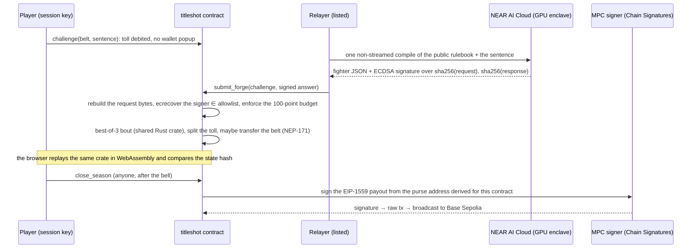

# TITLE SHOT

**Write one sentence. NEAR AI forges it into a fighter. Pay the toll, fight the champion, take the belt.**

A game for the NEAR HACKATHON (Games With Real Economies). Players turn sentences like *"a sleep-deprived lighthouse keeper
who fights with foghorn screams"* into fighters, pay a small toll to challenge the reigning champion sentence of a belt, and
get paid while their own sentence holds the belt. Every challenger pays the champion's writer, win or lose. When the season bell
rings, the NEAR contract pays the purse out on Base Sepolia through Chain Signatures: no person holds that key.

- **Play:** https://title-shot.pages.dev (a guest account is made for you; no wallet, no popup)
- **Judge mode:** https://title-shot.pages.dev/play?judge (a 3-minute checklist that follows you through the game)
- **Proof page:** https://title-shot.pages.dev/play/proof (deployed code hash, AI signer allowlist, solvency, Base purses, read live)
- **Demo video:** _added with the submission_
- **Network:** NEAR **testnet** (`ring.titleshot.testnet`) + Base **Sepolia**. Testnet tokens have no cash value.

## For judges: 3 minutes

| Do this | You should see |
|---|---|
| Open https://title-shot.pages.dev/play?judge and press **Get in the ring** | A NEAR testnet account made for you with fight money. No wallet, no popup. |
| Open a belt, write a sentence, press **Spar first** | Your fighter (name, title, three moves, stats), NEAR AI's signature, and your odds from 200 bouts simulated in your browser with the same Rust referee the contract runs. |
| Press **Challenge · 0.05 NEAR** | Toll paid → forge request on chain → NEAR AI compiles → the contract checks the signature → best-of-three bout, replayed here with "replayed here" next to the referee hash. |
| Win, or watch someone win | The belt (an NEP-171 token) moves to the winner's account in the same transaction. |
| Open **Tale of the tape** | The deployed code hash equals `sha256(contract/res/titleshot.wasm)`, the AI signer allowlist, solvency, each season's Base purse address and balance. |
| Read [docs/CHEAT-RESULTS.md](docs/CHEAT-RESULTS.md) | A tampered fighter, a swapped sentence, an unknown signer and a replay, each refused on testnet with its transaction. |
| Run `node scripts/verify-attestation.mjs --offline` (install its two packages first: [docs/ATTESTATION.md](docs/ATTESTATION.md)) | The allowlisted signer is NEAR AI's attested enclave key: Intel TDX quote, GPU evidence and booted code checked against a report recorded on 14 Nov. Expected: `PASS OFFLINE (6/7)`, since nonce freshness needs a live run. "Offline" means no NEAR AI call; it still fetches Intel and NVIDIA collateral and reads the testnet allowlist. |
| Open bout [#6](https://title-shot.pages.dev/play/bout/6), or run `(cd web && pnpm i)` then `node scripts/x402-agent.mjs --belt 1 --sentence "…" --dry-run` | An AI agent bought that title shot on Base with USDC over x402: the announcer calls "a challenger… from Base!" and the poster is tagged "Booked on Base". The dry run shows quote → 402 → signed EIP-3009 payment → the facilitator's `/verify` verdict without paying. With no key set it signs with a throwaway key, so `/verify` reports that key's empty balance. |

## How one challenge works



The relayer can deliver NEAR AI's answer or withhold it; it cannot change it, because the contract rebuilds the exact request
bytes from the sentence and the public rulebook and checks the model's enclave signature. A challenge nobody delivers expires
after 10 minutes and anyone can refund it (toll back minus the forge fee).

## Proof, on testnet

| Claim | Evidence |
|---|---|
| A guest challenges with a session key, the contract verifies NEAR AI's compile, runs the bout and moves the belt | challenge [57uSK111…](https://testnet.nearblocks.io/txns/57uSK111FowVFmxt5uYjbP3sBFQH6s2xA3ySpBxD7a2W) → delivery [2NUtsC89…](https://testnet.nearblocks.io/txns/2NUtsC89ocMDBTUFyysBGau5T5aaepxXnrEa7mFPCwdz) (`forged`, `nft_transfer` vance → jolly-mantis-52, `title_change`, bout #5) |
| The AI promoter writes each season's opener with NEAR AI and opens the season on chain | `open_season` [A6e2zPxm…](https://testnet.nearblocks.io/txns/A6e2zPxmQQVLdrURHkZ7XngwE31bhndWFqqbSxuLmL4M) ("night-shift florist…") → verified compile [DzBaHG1A…](https://testnet.nearblocks.io/txns/DzBaHG1AJmAn77YztSY6HrAfkFob63BrVnScaWYRiNyr) |
| The promoter funds each purse from its own Chain Signatures Base address | [0x81abd838…](https://sepolia.basescan.org/tx/0x81abd83885d93240b3b8cd334228bbadf12286b7e93282c5d150fc6a97e48f08), [0x64dece74…](https://sepolia.basescan.org/tx/0x64dece748cdc3c35eed64fd13e4bbc1483cb1cc8599c408be35682d25adaafad), [0x657a4dfd…](https://sepolia.basescan.org/tx/0x657a4dfd402539688c4fd8d500a3b4f65c282b7afafea7ecdc8844cf8518217f) |
| An AI agent buys a title shot on Base over x402 and the fight happens on NEAR | Base settle [0xbe901c98…](https://sepolia.basescan.org/tx/0xbe901c98f3e376e91b3a30b21231d2ab3807cb30f725dc16e35d42c2f703cb2c) → NEAR challenge [6Xk2S1j5…](https://testnet.nearblocks.io/txns/6Xk2S1j5PWB5FWwULf5n5F4JTztPRM13ATe8j9XDRkHV) (fight #3: the challenger from Base took the Tide Belt) |
| House NPCs keep the arena alive | house-a challenge [GTQGLtWp…](https://testnet.nearblocks.io/txns/GTQGLtWppmTzmMjjtec3yrvNHWgraBJKY6cWKxit73b7) → bout #2 |
| The contract refuses cheats | tampered fighter [Cnmh5urE…](https://testnet.nearblocks.io/txns/Cnmh5urEDPyC7ouKdy4oxcc7P8FomCR9yTxaymqge6Qq), swapped sentence [DQDXgmeD…](https://testnet.nearblocks.io/txns/DQDXgmeDByFuvrzo4ffQFbsKPAvRUhJnesq9bhPFBPBQ), unknown signer [5EZFVkNE…](https://testnet.nearblocks.io/txns/5EZFVkNEDxREDkty5bmNHfLZgrgTujJ1fjoACuvDnmiJ) (all `E_AI_SIG`, toll refunded minus fee and storage), replay [9zxVTFWD…](https://testnet.nearblocks.io/txns/9zxVTFWDUzcdsk1eW3L4VwdRox4d41hk5AUjoejSxYqS) (`E_NOT_FORGING`). See [docs/CHEAT-RESULTS.md](docs/CHEAT-RESULTS.md). |
| A NEAR account owns a Base name through Chain Signatures | `velvetvance.basetest.eth`: MPC sign [EU8Zyc9c…](https://testnet.nearblocks.io/txns/EU8Zyc9coX2GBXrrotCqkKjUpj1DayDqJwpA1LetpZk7) → Base [0x60181a7b…](https://sepolia.basescan.org/tx/0x60181a7bc1519285d64938791b20f10fa9917ebee4633a346fdc119ad967ef0b) |
| The allowlisted signer is NEAR AI's attested key | `node scripts/verify-attestation.mjs`: 7/7 PASS live; `--offline` from the recorded report in `vectors/`. See [docs/ATTESTATION.md](docs/ATTESTATION.md). |
| A NEAR contract signs a Base payout through Chain Signatures and it mines | Tide Belt season 3 bell: [close_season ENpMwjn2…](https://testnet.nearblocks.io/txns/ENpMwjn28rh4N5VQv26sFVu12gjwjvKxCywbRL8QcoL2) → [sign_payout 5Rd6vz22…](https://testnet.nearblocks.io/txns/5Rd6vz22Lr2pz56kuNZ7PnE1BGFZZVs3ijK1xm5mEeRf) (payout 7: one defence's share to the bout #10 writer) → [Base 0xb1fff6c2…](https://sepolia.basescan.org/tx/0xb1fff6c2c102349ab3f2935b0d4977720762b1be93e0efbfb5a9b690ed1c5e6d), sent from the season's derived purse to `ringside-agent.basetest.eth`. All 8 payouts of the first three bells mined ([Midnight](https://testnet.nearblocks.io/txns/9XejLYWvj1vYM9X1zqYo7GSfiSaUqB6eQcK8yqBNJC75): 3, Tide: 4, [Wildcard](https://testnet.nearblocks.io/txns/2yiC2K7TcDkmPCNWbjv33H81bkQHaWWcj2uHTnrmXtHU): 1 → [Base 0x749bc902…](https://sepolia.basescan.org/tx/0x749bc90298d05929b7cba2a44bb9fabe500d3a2d082a1a2729810109b268bdc5)). |

## Which NEAR pieces do what

| Piece | Job in the game | Without it | Code |
|---|---|---|---|
| NEAR AI Cloud | Compiles a sentence into a fighter under a public rulebook and signs every response from a GPU enclave. Also writes the promoter's openers and the house NPCs' sentences, and paints each fighter's portrait (FLUX, signed). | The compiler becomes our server and could quietly favour a champion. | `crates/bout-sim/src/rulebook.rs`, `contract/src/verify.rs` |
| NEAR contract | The referee: rebuilds the exact request bytes, `ecrecover`s the AI signature against a timelocked allowlist, enforces the 100-point budget, runs the bout from the same Rust crate the browser runs, splits tolls, runs seasons, refunds. | A server decides winners; nobody can check. | `contract/`, `crates/bout-sim/` |
| Function-call keys | The browser holds a key that can only call `challenge`. Value-moving methods need 1 yoctoNEAR, which a function-call key cannot attach. | A wallet popup on every challenge. | `web/src/game/near.ts`, `web/functions/_lib/guest.ts` |
| Chain Signatures | Each season's purse sits at a Base Sepolia address derived from the contract; only `close_season` → `sign_payout` can move it, only to the winners. The promoter also funds purses and owns a Base name from its own derived address. | The purse becomes our custody. | `contract/src/payout.rs`, `web/functions/_lib/purse.ts` |
| NEAR Connect + NEP-413 | Beside the no-wallet guest route, **Use my NEAR wallet** (`@hot-labs/near-connect`, testnet: Meteor, Intear, Nightly, Ledger and the others the connector lists) asks for one approval that adds a `challenge`-only session key and deposits fight money; the wallet account then fights with no popups, and withdrawals and payout addresses go through the wallet. A guest can **Move to my wallet**: the wallet proves control with a NEP-413 signed message (server-issued single-use nonce, recipient bound to this site, full-access key checked on chain), then the guest's own key withdraws its balance, transfers its belts and sends its NEAR. | Players are limited to throwaway guest corners. | `web/src/game/wallet/`, `web/functions/api/auth/`, `web/functions/_lib/nep413*.ts` |
| NEP-171 | The belt is a token. Whoever holds it collects the champion's share of every challenge and can hand it over with `nft_transfer`. | No ownable title. | `contract/src/nft.rs` |
| OutLayer | Built and deployed: `forge.wasm` runs the compile inside Intel TDX with the API key sealed to the game contract and draws the fight seed from OutLayer's VRF (verified on chain in the spike, [DF3eEa9o…](https://testnet.nearblocks.io/txns/DF3eEa9oedQeFbs34dJY9hV3DfkCrsujkQEscjiaQtTx)). On testnet today OutLayer does not return our compile runs, so the live contract runs in relayer mode (see "What we do not claim"). | The API key sits with the relayer. | `forge/`, `contract/src/challenge.rs` |

## Beyond NEAR

| Integration | What it does here | Code |
|---|---|---|
| **x402 on Base** | AI agents (or anyone on Base) buy a title shot with test USDC. The payment lands at the promoter's Chain Signatures address; the backend settles it through the public x402 facilitator and books the challenge on NEAR for the payer. Bots that search for strong sentences become paying challengers: the champion's writer gets the same share of their toll. | `web/functions/_lib/x402.ts`, `boxoffice*.ts`, `scripts/x402-agent.mjs`, [docs/BOXOFFICE.md](docs/BOXOFFICE.md) |
| **Basenames** | Purses pay to `you.basetest.eth` as well as `0x…`; names shown are checked forward and in reverse. The promoter owns `velvetvance.basetest.eth`, registered by an MPC signature; the x402 demo agent's wallet owns `ringside-agent.basetest.eth` ([0x7ad56024…](https://sepolia.basescan.org/tx/0x7ad560247983f945a0f4628c4d20f056be443635b92784a48f417f85fb1b9fcb)). | `web/src/game/chain/basenames.ts`, `scripts/vance-basename.mts`, `scripts/agent-basename.mts`, [docs/BASENAMES.md](docs/BASENAMES.md) |
| **Your own EVM wallet for purses** | The payout dialog finds injected wallets with EIP-6963 (MetaMask, Rabby, Coinbase and others, each by its own name), switches to Base Sepolia, and has the wallet sign a message binding your NEAR account, the address, this site and a nonce. The signature is checked before `set_evm_address` (or `claim_payout` from the bell) records where your purse share is paid. Pasting an address or Basename still works, and is the default when the browser has no wallet. | `web/src/game/evm/`, `web/src/components/PayoutWallet.tsx` |
| **Intel TDX + NVIDIA attestation** | Ties the contract's signer allowlist to NEAR AI's hardware attestation: TDX quote, GPU evidence, booted code, report data binding the signing address. | `scripts/verify-attestation.mjs`, [docs/ATTESTATION.md](docs/ATTESTATION.md) |
| **ElevenLabs** | Announcer, promoter and crowd voices, fighters' battle cries, music and sound effects. | `web/src/audio/`, `assets/audio/` |
| **Cloudflare** | Pages Functions (guests, previews, portraits, box office, tick), KV, and a cron Worker that rings the bell every 5 minutes. | `web/functions/`, `worker-bell/` |

## The economy

- **Toll** 0.05 NEAR per challenge. The forge fee (0.01 NEAR, the AI compile and its delivery) comes off first, then the bytes
  the bout stores; of the rest **60% to the belt holder** (win or lose: they are paid for being the target), 25% to the promoter,
  10% to the season side-pot, 5% house. Exact to the yoctoNEAR, property-tested.
- **Purse at the bell:** 50% to the final holder, 50% split by successful defences, **capped at 25% of the purse per account**;
  a season with no challenges refunds the promoter. Seasons last 3 hours on testnet.
- **No token, no emissions.** Seasons are funded up front by the promoter.
- **Self-dealing loses money:** an alt-account challenge returns at most 95% of the remainder to the same person; the forge fee
  and the house share never come back (property test).
- **Velvet Vance** is an AI promoter with its own NEAR account and a Chain Signatures Base address. It writes each season's
  opening champion with NEAR AI, funds the purse from its Base address and earns the promoter share in NEAR and box-office
  income in USDC. **Mother Ruckus** and **Professor Quill** are house challengers that keep idle belts busy.
- **Sealed arena rule:** each season's modifier (e.g. "stun chances halved") is drawn from the seed of the season's first bout,
  so nobody, the promoter included, can tune the opener to it.

## Balance

`cargo run --release --bin sweep` in `crates/bout-sim` runs ~24M fights over 2,040 fighters × 8 arena rules, then an
adversarial hill-climb that searches for the strongest build and re-measures it on fresh seeds and opponents. All nine gates
pass (`crates/bout-sim/SWEEP.md`): best fighter in the field 59.4%, best optimizer-found build 61.5%, every top build has a
counter that beats it ≥55%, draw rate 5.0%, mean |p−0.5| between random builds 0.149 vs a pure-dice baseline of 0.028:
wording matters more than luck.

## What we do not claim

- **The live game runs in relayer mode.** OutLayer's worker never returned our compile runs on testnet
  ([GXcF8BEC…](https://testnet.nearblocks.io/txns/GXcF8BEC7uAihJ4rsDPJ1caGBMSjDTvwtiNZRowYo6Kw),
  [Gvcg3PPs…](https://testnet.nearblocks.io/txns/Gvcg3PPsccZnYx25hXRB8rJ45bb6tThPaC4zT7hwYsyn): "Execution promise failed",
  base fee only). The same `forge.wasm` compiles correctly under wasmtime (`forge/examples/compile_live.rs`), a direct
  OutLayer run returns its VRF ([CAqd6gpc…](https://testnet.nearblocks.io/txns/CAqd6gpcFqkxXnuMg9VmMRJPoRMgVDsJpcRn1MJB3qYm)),
  and >1 KB outputs return fine, so the failure is inside OutLayer's worker. In relayer mode the API key sits with our backend
  and the fight seed comes from the block, not a VRF. The contract switched modes through its public timelock
  ([6NMKEJNf…](https://testnet.nearblocks.io/txns/6NMKEJNfQsMhYBd2skkkex9haRWeNebGXHWWzZhpWfFt)).
- The model and rulebook are public, so anyone can search for strong sentences offline, bots included. Our own hill-climb
  shows how far that gets you (61.5% against the field, and every such build has a counter). The x402 box office makes
  such bots pay the champion like everyone else.
- The contract checks AI signatures against an owner-set, timelocked allowlist. It does not verify the hardware quote itself;
  `scripts/verify-attestation.mjs` does that off chain.
- The x402 payment → NEAR booking hop is a trusted relay by our backend; nothing on chain ties the Base payment to the
  NEAR challenge.
- "Exactly once" is not claimed: only the first delivered result per challenge counts, and the first settled compile of a
  sentence is final, so a re-delivery can never change a fighter.
- The promoter's Base wallet is pre-funded with test ETH; there is no testnet route to swap its NEAR income into purses.
- One payout needed a hand top-up. The contract signs value + gas × max fee = the purse, but every Base tx also pays an
  L1 data fee, so the Wildcard Belt's single 100% payout was refused as "insufficient funds" until we sent its purse
  0.00001 test ETH. Purses now carry that reserve on top of the declared amount (`web/functions/_lib/purse.ts`).
- Wallets: every wallet path ran end to end on testnet with test wallets we control: a debug wallet registered with NEAR
  Connect (session key [BBxYiP6z…](https://testnet.nearblocks.io/txns/BBxYiP6zxQicXVFkWxiRHBpUmdarWpbYDECYRAYoJBEm), deposit
  [CwxCsJyY…](https://testnet.nearblocks.io/txns/CwxCsJyYLViCRS5mDEzqHoPQ67SBvJRdVEzTvLLUwTei), a popup-free challenge
  [BmoWk4Ah…](https://testnet.nearblocks.io/txns/BmoWk4Ahv6w4E5b9vcQhVpRJr1kbdajiW7sXjKjd6EMn), a guest's move
  [GLnuuZrT…](https://testnet.nearblocks.io/txns/GLnuuZrTkg44yd7EyzaWq48ZJP2gwC1Vs114siAkzT8A)) and a scripted EIP-1193 wallet
  ([Hw1Hm7sx…](https://testnet.nearblocks.io/txns/Hw1Hm7sxrV4ktBBv5F1u1e4woYwho67DBTKL4YiLfZzC)). Real wallet apps (Meteor,
  Intear, MetaMask, Rabby…) were not in our automated tests; whether a given wallet accepts the session-key request in a
  batch, or NEP-413 message signing, is up to that wallet. Moving a belt with `nft_transfer` is unit-tested, not run live.
  Smart-contract EVM wallets cannot sign the ownership message, so they use the paste path. Not integrated: FastAuth social
  login (on 14 Nov the shared testnet Auth0 client accepted only `http://localhost:3000` as a callback and answered 403
  "Callback URL mismatch" for this site, and testnet has no public FastAuth relayer), HOT Kit and WalletConnect (they need
  keys this build does not have), and passkey or EVM-controlled NEAR accounts (mainnet-only today).
- Testnet only. Testnet NEAR, Sepolia ETH and test USDC have no value.

## Tests

| Layer | Count | Run |
|---|---|---|
| Rules + referee (`crates/bout-sim`) | 53 + 9 balance gates | `cargo test --release`, `cargo run --release --bin sweep` |
| Contract unit | 60 | `cd contract && cargo test --lib` |
| Contract sandbox (real wasm, mock OutLayer + MPC signer) | 68, run on the deployed wasm (about 13 min; the first run downloads the near-sandbox binary) | `cd contract/it && ./run.sh` |
| Forge (host + inside wasm) | 20 | `cd forge && cargo test --lib` |
| Web client + Pages Functions | 612 | `cd web && pnpm test` |
| Recorded NEAR AI signatures | 44/44 | `cd spikes/ecrecover && node scripts/verify-offline.mjs` |

## Reproduce

Prerequisites: Rust (the contract and its mocks pin 1.86.0 in `rust-toolchain.toml`; the other crates use stable),
`cargo-near` 0.17, `wasm-bindgen-cli` 0.2.130 (`build-web.sh` installs it if missing), binaryen's `wasm-opt`, Node 22+,
pnpm. All crates share one target directory (`.cargo/config.toml`). Every block below starts from the repo root.

```sh
# the deployed contract: the committed wasm hashes to the code hash on chain and on the proof page
shasum -a 256 contract/res/titleshot.wasm             # 843869206ec5c38e…f88333 (check this before build.sh overwrites it)

# shared rules + referee (no network)
(cd crates/bout-sim && cargo test --release && cargo run --release --bin sweep)
(cd crates/bout-sim && ./build-web.sh && node scripts/replay-golden.mjs)   # wasm replays 20 golden fights, identical hashes

# contract: unit + sandbox tests (mock OutLayer and mock MPC signer; the first sandbox run downloads near-sandbox)
(cd contract && ./build.sh && cargo test --lib && cd it && ./run.sh)

# AI signatures (recorded, 44 checks) and attestation (install its two packages first: docs/ATTESTATION.md)
(cd spikes/ecrecover && npm i && node scripts/verify-offline.mjs)
node scripts/verify-attestation.mjs --offline           # PASS OFFLINE (6/7): nonce freshness needs a live run

# web + API
(cd web && pnpm i && pnpm test && pnpm build)
```

`build.sh` remaps home and toolchain paths out of the binary, so no machine path ships in it. Rebuilds are not
byte-identical (cargo hashes build metadata, including the `bout-sim` path dependency's location, into the binary; two
builds differ in a few hundred bytes), so the committed wasm is the reference: it is the file deployed, and its sha256 is
the code hash on chain.

## Deployed accounts (testnet)

| What | Account / address |
|---|---|
| Game contract | [`ring.titleshot.testnet`](https://testnet.nearblocks.io/address/ring.titleshot.testnet) (owner `titleshot.testnet`) |
| Relayer | `relay.titleshot.testnet` |
| Promoter NPC | `vance.titleshot.testnet` · Base [`0xedc7…4d49`](https://sepolia.basescan.org/address/0xedc7423225a2afc44375cf36feffc4119b484d49) · `velvetvance.basetest.eth` |
| House NPCs | `house-a.titleshot.testnet` (Mother Ruckus), `house-b.titleshot.testnet` (Professor Quill) |
| MPC signer | `v1.signer-prod.testnet` |
| OutLayer project | `titleshot.testnet/titleshot-forge` (forge `2c2b3052…`) |

## Repository

`crates/bout-sim` rules, referee, rulebook prompt · `contract` the game contract · `forge` the OutLayer app · `web` client +
Cloudflare Pages Functions (guests, previews, portraits, box office, promoter and house tick) · `worker-bell` the cron ·
`scripts` deploy, attestation, cheat and agent scripts · `spikes` de-risk proofs · `assets` art prompts and audio pipeline ·
`docs` architecture and interface contracts.

Art: generated through ChatGPT's image generation (via Codex CLI's image tool) from the prompts in `assets/art/prompts`. Each
image carries an OpenAI C2PA content credential naming the generator `ChatGPT` / `gpt-image`; neither the credential nor
ChatGPT's interface shows a version number, so we don't state one. Fighter portraits: NEAR AI Cloud (FLUX.2-klein-4B), signed.
Voice, music and sound effects: ElevenLabs.

## License

MIT
