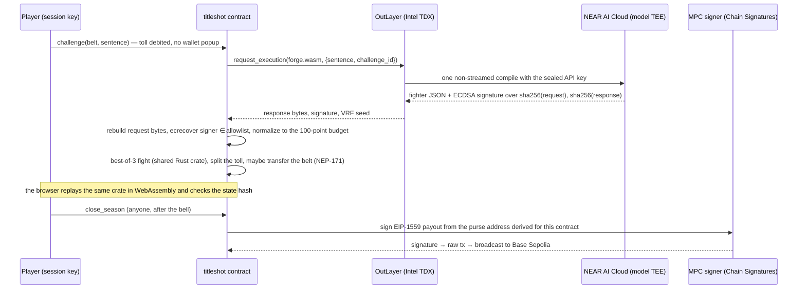

# TITLE SHOT

**Write one sentence. An attested AI forges it into a fighter. Pay the toll, fight the champion, take the belt.**

A game for the NEAR HACKATHON (Games With Real Economies). Players turn sentences like *"a pigeon with a law
degree"* into fighters, pay a small toll to challenge the reigning champion sentence of a belt, and get paid when
their own sentence holds the belt. Every failed challenger pays the champion's writer. When the season bell rings, a
NEAR contract pays the purse out on Base Sepolia through Chain Signatures: no person holds that key.

- Live (preview): https://preview.title-shot.pages.dev
- Demo video: _added with the submission_
- Network: NEAR **testnet** + Base **Sepolia**. Testnet tokens have no cash value.

> Status of this README: sections marked **pending live run** are filled with transaction links once the end-to-end
> testnet run completes. Everything else describes code that is in this repository and tested.

## How one challenge works



## Which NEAR pieces do what

| Piece | Job in the game | Without it | Code |
|---|---|---|---|
| NEAR AI Cloud | Compiles a sentence into a fighter under a public rulebook; signs every response. The contract verifies the signature (`ecrecover`) and rebuilds the request bytes itself, so it knows exactly which sentence and rulebook were compiled. | The compiler becomes our server and could quietly favour a champion. | `crates/bout-sim/src/rulebook.rs`, `contract/src/verify.rs` |
| OutLayer | Runs `forge.wasm` exactly once per paid challenge inside Intel TDX, holding the API key as a secret no operator sees; draws the fight seed from its VRF. | A relayer holding the key could re-roll compiles or drop challenges. | `forge/`, `contract/src/challenge.rs` |
| NEAR contract | The referee: budget enforcement, the fight, toll splits, seasons, refunds. The same `bout-sim` crate runs in the browser for replays. | A server decides winners; nobody can check. | `contract/`, `crates/bout-sim/` |
| Function-call keys | The browser holds a key that can only call `challenge`. Value-moving methods need 1 yoctoNEAR, which a function-call key cannot attach. | A wallet popup on every challenge. | `contract/src/challenge.rs`, `web/src/game/near.ts` |
| Chain Signatures | Each season's purse sits at a Base Sepolia address derived from the contract; only `close_season` → `sign_payout` can move it, only to the winners. | The purse becomes our custody. | `contract/src/payout.rs` |
| NEP-171 | The belt is a token. Whoever holds it collects the champion's share and can transfer it. | No ownable title. | `contract/src/nft.rs` |

## The economy

- **Toll split** (per challenge, exact to the yoctoNEAR, property-tested): forge fee first (OutLayer + AI at cost),
  then of the rest 60% to the belt holder (win or lose: they are paid for being the target), 25% to the promoter,
  10% to the season side-pot, 5% house.
- **Purse at the bell**: 50% to the final holder, 50% split by successful defences, **capped at 25% of the purse per
  account**; a season with no challenges refunds the promoter.
- **No token, no emissions, no faucet.** Seasons are closed and funded up front by the promoter.
- **Self-dealing loses money**: an alt-account challenge returns at most 95% of the remainder to the same person;
  the forge fee and the house share never come back (property test).
- **Velvet Vance** is an AI promoter with its own NEAR account and a Chain Signatures Base address. It writes each
  season's opening champion with NEAR AI, funds the purse from its Base address and earns the promoter share.

## Balance

`cargo run --release --bin sweep` in `crates/bout-sim` runs ~24M fights over 2,040 fighters × 8 arena rules, then an
adversarial hill-climb (gate G9) that searches for the strongest possible build and re-measures it on fresh seeds and
fresh opponents. All nine gates pass (`crates/bout-sim/SWEEP.md`): best fighter in the field 59.4%, best optimizer-found
build 61.5% (62.2% in the deepest independent climb), every top build has a counter that beats it ≥55%, draw rate 5.0%,
mean |p−0.5| between random builds 0.149 vs a pure-dice baseline of 0.028: wording matters more than luck.

## What we do not claim

- The model and rulebook are public. Anyone can search for strong sentences offline, bots included. Our own
  hill-climb shows how far that gets you (about 62% against the field, and every such build has a counter). The sealed
  season rule, the defence-weighted purse and the per-account cap blunt the rest; they do not prevent it.
- The AI signer allowlist is set by the contract owner from the model's attestation report; changes are timelocked.
- OutLayer's DAO can reach the master secret per its own docs, so "nobody can read the key" is not claimed.
- Testnet only. Testnet NEAR and Sepolia ETH have no value.

## Reproduce

Prerequisites: Rust 1.86 (`rust-toolchain.toml` pins it per crate), `cargo-near`, Node 22+, pnpm.

```sh
# shared rules + referee (no network)
cd crates/bout-sim && cargo test --release && cargo run --release --bin sweep
./build-web.sh && node scripts/replay-golden.mjs     # wasm replays 20 golden fights with identical hashes

# contract: unit + sandbox tests (no network; mock OutLayer and mock MPC signer)
cd contract && ./build.sh && cargo test && (cd it && cargo test)

# signature verification against recorded NEAR AI vectors (no keys needed)
cd spikes/ecrecover && npm i && node scripts/verify-offline.mjs

# web + API
cd web && pnpm i && pnpm test && pnpm build
```

## Deployed accounts (testnet) — pending live run

| What | Account / address |
|---|---|
| Game contract | _pending_ |
| OutLayer project | `titleshot.testnet/titleshot-forge` |
| Promoter NPC | `vance.titleshot.testnet` |
| MPC signer | `v1.signer-prod.testnet` |

## Evidence so far (spikes)

| Claim | Transaction |
|---|---|
| A NEAR contract signed a Base Sepolia payout via Chain Signatures and it mined | [NEAR](https://testnet.nearblocks.io/txns/5YRNw3d1SehmYN4373RYA9pGka8wHMryKKmtwxa3jfBZ) → [Base Sepolia](https://sepolia.basescan.org/tx/0xdcf99b7fcd1b987daca12ccc691b020eb78109b261276f186ea60a7380cfc741) |
| OutLayer TEE reached NEAR AI Cloud over HTTPS | [4yt8E5sw…](https://explorer.testnet.near.org/transactions/4yt8E5swTLKtjsJgRxfDtT6ES7Jftv1smrSmGccVGg8u) |
| OutLayer VRF seed returned to our contract and verified on chain | [DF3eEa9o…](https://explorer.testnet.near.org/transactions/DF3eEa9oedQeFbs34dJY9hV3DfkCrsujkQEscjiaQtTx) |

## Repository

`crates/bout-sim` rules, referee, rulebook prompt · `contract` the game contract · `forge` the OutLayer app ·
`web` client + Cloudflare Pages Functions (preview compile, guest accounts, promoter tick) · `spikes` de-risk proofs ·
`assets` art prompts and audio pipeline · `docs` architecture and interface contracts.

Art: generated with an image model from prompts in `assets/art/prompts`. Voice, music and sound effects: ElevenLabs.

## License

MIT
