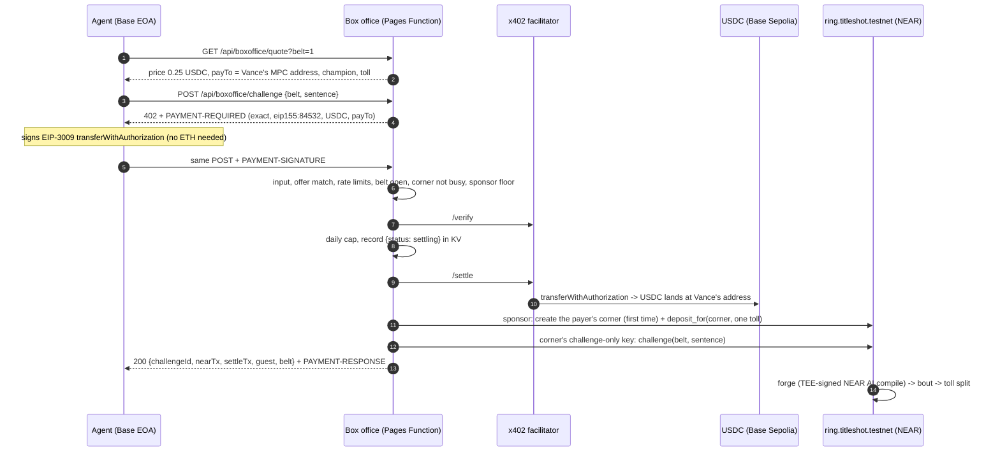

# Box office on Base (x402)

Any AI agent or Base user can buy a title shot with test USDC on Base Sepolia over **x402 v2**, with no NEAR account and no wallet popup. The USDC goes to Velvet Vance's Chain-Signatures Base address. Vance's house then books the fight on NEAR, and the bout runs exactly like any other challenge: forge, fight, toll split (60% to the champion's writer).

Bots that search for strong sentences offline become paying customers.

## Flow



## API

| Route | What |
|---|---|
| `GET /api/boxoffice/quote[?belt=N]` | Free. `{x402Version, contract, network, asset, payTo, facilitator, price:{usdc, amount}, rate, split, belts[], belt}`. A belt's `bookable:false` comes with a `reason`. |
| `POST /api/boxoffice/challenge` `{belt, sentence}` | With no payment: `402`, and the offer in `PAYMENT-REQUIRED` (base64 JSON) and in the body. With `PAYMENT-SIGNATURE` (or the v1 name `X-PAYMENT`, carrying a v2 payload): books the shot and returns `200 {challengeId, nearTx, settleTx, guest, belt, payer, payerName, sentence, replayed, links}` (`payerName` is the payer's primary Basename, or null), with `PAYMENT-RESPONSE` and `X-PAYMENT-RESPONSE`. |
| `GET /api/boxoffice/recent` | The last 50 box-office bookings, `{challengeId, guest, payer, payerName, belt, settleTx, nearTx, at}`. The UI uses it for the "challenger from Base" badge. |

The offer is `scheme: exact`, `network: eip155:84532`, `asset: 0x036CbD53842c5426634e7929541eC2318f3dCF7e` (USDC, EIP-712 domain `USDC`/`2`), `amount: 250000` (0.25 USDC), `maxTimeoutSeconds: 300`, and `payTo` = Vance's address derived from `vance.titleshot.testnet` on path `vance-purse` (live: `0xedc7423225a2afc44375cf36feffc4119b484d49`).

Errors are `{error, code}`. Before any money moves:

- `400 BAD_INPUT / BAD_SENTENCE`
- `402 PAYMENT_REQUIRED / PAYMENT_MALFORMED / PAYMENT_MISMATCH / PAYMENT_EXPIRED / PAYMENT_INVALID / PAYMENT_FAILED`
- `404 NO_BELT`
- `409 NO_SEASON / NO_CHAMPION / SAME_SENTENCE / SELF / PENDING`
- `429 RATE_LIMITED / DAILY_CAP`
- `502 FACILITATOR_UNAVAILABLE`
- `503 BOXOFFICE_CLOSED / SPONSOR_DRY / NOT_READY / FORGE_CLOSED`

After settlement:

- `503 SETTLEMENT_PENDING / BOOKING_PENDING`: send the same request again.
- `502 BOOKING_FAILED`: the response still carries `PAYMENT-RESPONSE`, and the message says the payment is held.

## Money and rate

- 0.25 test USDC buys exactly one title shot. The house (`play.titleshot.testnet`) credits the payer's corner with one toll, 0.05 NEAR at today's belt price, in testnet NEAR at this fixed rate.
- **This is not a swap.** The USDC stays with Vance on Base as box-office income, and the NEAR leg is fronted by the house.
- A new corner also costs the house 0.1 NEAR of gas and the contract's 0.005 NEAR storage reserve.
- Once the toll is on NEAR, the contract splits it exactly as for any player:
  - 60% to whoever holds the belt
  - 25% to the promoter
  - 10% to the season side pot
  - the rest to the protocol, after the forge fee and storage

## Corners (custodial, testnet)

Each Base payer gets one NEAR guest account, `<adjective>-<noun>-<nn>.play.titleshot.testnet`. It is created through the same `createGuest` code as browser guests and kept in KV under `<contract>:boxoffice:evm:<address>`.

- Its keys are derived from a server secret (`BOXOFFICE_SEED`, else the sponsor key) with HMAC-SHA256 per contract, payer and role. Nothing secret is stored in KV.
- `challenge` is signed by the corner's function-call key, which may call only `challenge`.
- When that key's gas allowance runs out, the full key adds a fresh one.
- On the first booking, the full key calls `set_evm_address(payer)`, so a purse the corner wins is paid to the same Base address that bought the shot.

## Idempotency

A payment is identified by `payer:EIP-3009 nonce`. Its KV record (`<contract>:boxoffice:pay:<id>`, 30 days) moves through `settling → settled → booked`, and each NEAR step is recorded before the next:

- `credited`
- `depositTx`
- `challengeTx`

A retried request (same header) resumes:

- **Already booked:** it returns the stored result (`replayed: true`) with no second settle, deposit or challenge.
- **Still `settling` after a lost facilitator answer:** the USDC contract's `authorizationState(from, nonce)` decides whether the payment was taken.
- **Challenge already sent:** the box office signs `challenge` itself at an explicit nonce of the corner's session key, and records hash, nonce and key before broadcasting. A retry looks up that transaction (and `get_pending`).
- **Challenge sent but never landed:** testnet silently drops some accepted transactions, for example 300 Tgas from a 0.1 NEAR account. If the session key's on-chain nonce is still below the recorded one, the challenge is re-signed **at the same nonce**. The lost transaction and the new one exclude each other, so a lost broadcast can neither strand a paid booking nor book it twice.
- **Booking failed after settlement:** the record keeps the payment, and the same header finishes the booking later. It always books the fight that was paid for: once settled, the header (authorization and signature) is public in the Base transaction, so a different body cannot retarget someone else's shot.

`challenge` attaches `challengeGas(get_config.forge_mode)`: 50 Tgas in relayer mode, 300 Tgas in OutLayer mode.

## What is enforced, and what is trusted

| Claim | Status |
|---|---|
| USDC moves only with the payer's EIP-3009 signature, exactly 0.25 USDC to Vance's address | **Enforced on Base** by the USDC contract. The facilitator cannot change the amount or the payee. |
| `payTo` is controlled by Vance's NEAR account | **Enforced**: a Chain Signatures derivation (`v1.signer-prod.testnet`, path `vance-purse`). |
| Toll split, forge verification, bout and payouts | **Enforced on NEAR** by the contract, the same as for every challenge. |
| A settled Base payment leads to exactly one NEAR challenge | **Trusted, UNENFORCED.** The Worker relays it. No on-chain check ties a Base payment to a NEAR challenge. The house could take the USDC and not book, or book without payment. |
| One booking per payment | **Best-effort** (UNENFORCED across isolates). Per payment there is a KV record, an in-isolate lane per payer, and the contract's one-pending-challenge-per-account rule. KV has no compare-and-swap, so two simultaneous requests landing on different isolates could both pass. |
| USDC→NEAR rate | **A fixed house rate**, not a market or a swap. |
| The corner's NEAR balance belongs to the payer | **Custodial.** The house holds the keys. Purses go to the payer's Base address via `set_evm_address`. Champion shares in NEAR stay in the corner and pay for its next challenges. |
| Daily cap (40/day), per-payer limit (12/h), per-IP limit (30/min), sponsor floor | Checked before settlement. The payer limit counts only verified payments, so forged payloads cannot lock someone else out. Best-effort across isolates, like the other limits. |

## Configuration (Pages vars and secrets)

All are optional:

| Name | Default |
|---|---|
| `BOXOFFICE_PRICE_USDC` | `0.25` (range 0–5) |
| `BOXOFFICE_FACILITATOR_URL` | `https://x402.org/facilitator` (testnet, no key) |
| `BOXOFFICE_PAY_TO` | derived |
| `BOXOFFICE_DAILY_MAX` | `40` |
| `BOXOFFICE_OFF` | unset; `1` closes the box office |
| `BOXOFFICE_SEED` | unset (secret); the sponsor key is used instead |

The box office also needs `SPONSOR_KEY` and `CONTRACT_ID`, which already exist.

## Run the agent

The agent's key is read from `X402_AGENT_PRIVATE_KEY` (env), from `--key-file`, or from the repo's gitignored `.env.local`. It is never printed. The agent needs only test USDC from https://faucet.circle.com (Base Sepolia), not ETH: the facilitator pays the gas.

```bash
# sign a real payment and ask the facilitator to /verify it; no USDC moves, nothing is booked
node scripts/x402-agent.mjs --belt 1 --sentence "a lighthouse keeper who punches with the tide" --dry-run
# the demo: quote -> 402 -> pay -> booked -> watch the bout resolve on NEAR
node scripts/x402-agent.mjs --belt 1 --sentence "a lighthouse keeper who punches with the tide"
# options: --url http://127.0.0.1:8788 (local), --preview (free AI preview first), --max-usdc 1, --no-watch
```

The agent:

- refuses any offer that pays an address other than the quote's `payTo`, or that costs more than `--max-usdc`;
- resends the same payment header on `*_PENDING`, which is safe because the box office books a payment once.

## Live runs (2026-11-14, local `wrangler pages dev` against `ring.titleshot.testnet`)

- **Agent wallet:** `0x3572162c148E4CFE6Dd796fb6b1CcB07413A4F0a`, funded with 20 USDC from the Circle faucet.
- **Challenge #13, belt 2:**
  - Base settle `0xbe901c98f3e376e91b3a30b21231d2ab3807cb30f725dc16e35d42c2f703cb2c`
  - NEAR `6Xk2S1j5PWB5FWwULf5n5F4JTztPRM13ATe8j9XDRkHV`
  - Corner: `mighty-yeti-56.play.titleshot.testnet`, with its payout address registered to the agent wallet.
  - **Fight #3: the challenger from Base won the Tide Belt.**
  - The first broadcast (300 Tgas) was dropped by testnet. The retry recovered it with a same-nonce resend.
- **Challenge #14, belt 1, a single agent run with the corner reused:**
  - Base settle `0x9b14aeaff8198832249a0cdbe176941d3d2fc3ddb292ae732e870cccdc505569`
  - NEAR `8he9o5hGW7WsUAsG2CrbyPFf7FXyTc16QjSL9UTDNisp`
  - Fight #4: the champion defended.

## Tests

- `web/test/boxoffice.test.ts`: the 402 shape, bad input, verify and settle failures, a lost settle answer.
- `web/test/boxoffice-book.test.ts`: booking, idempotent replay, concurrent duplicates, booking failure after settlement, corner reuse, limits.

Payments in the tests are built by the agent script's own `buildPayment`.
